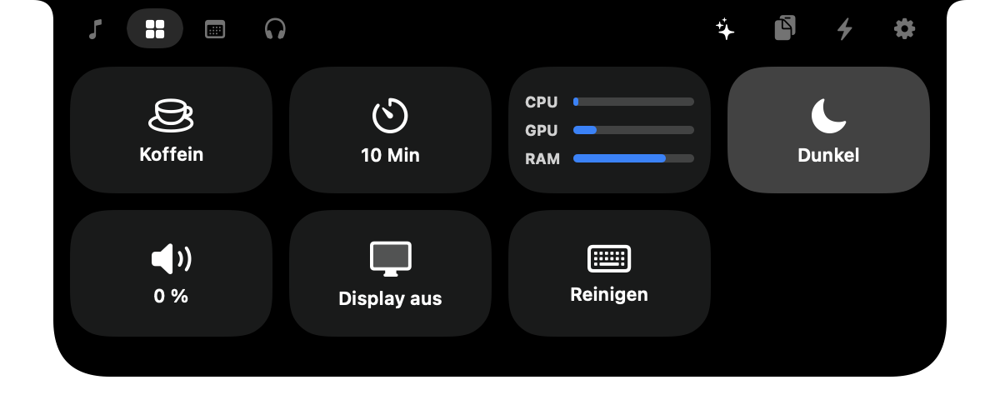
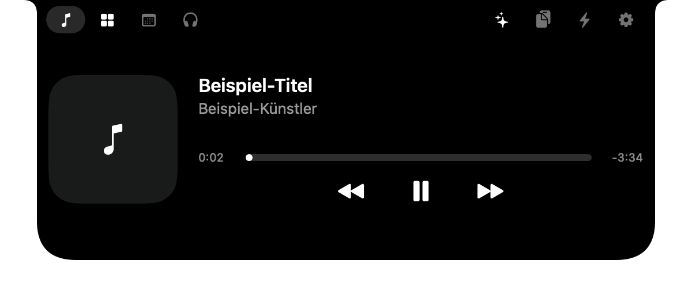
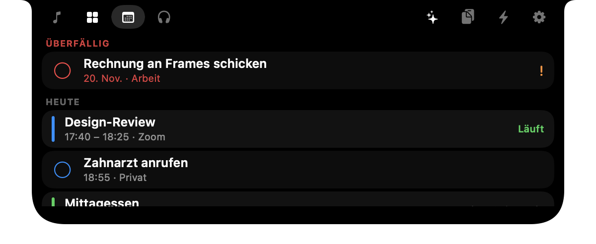
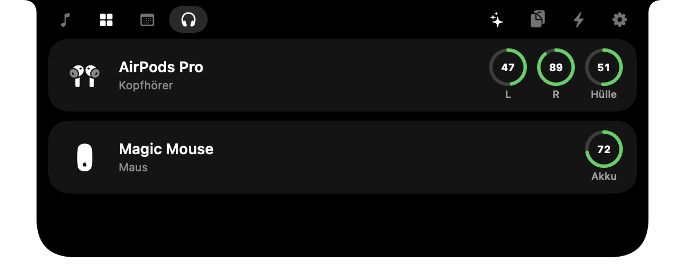
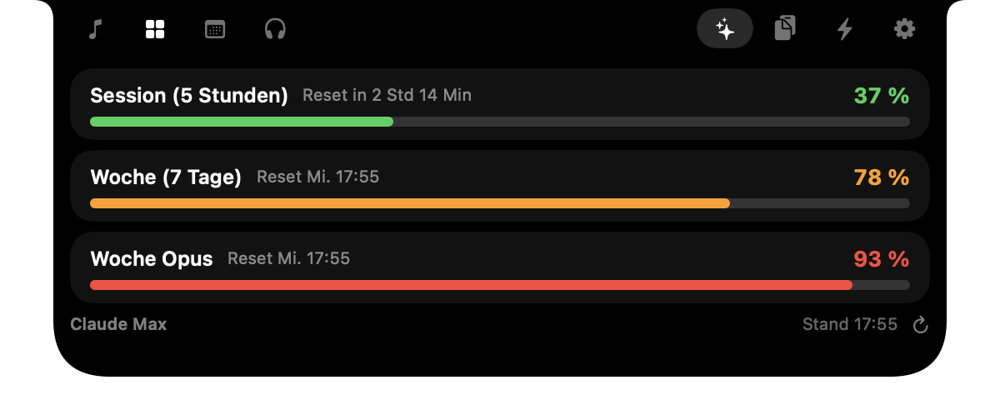
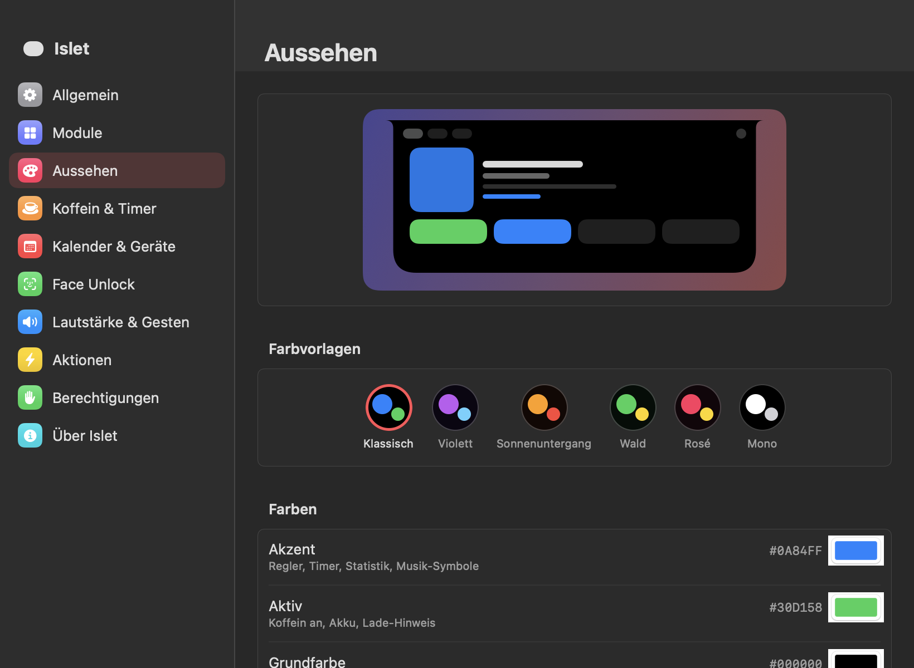

<div align="center">

# Islet

**Eine schlanke Dynamic Island für die Notch deines Macs.**
Musik, Timer, Termine, AirPods-Akku, Face Unlock und mehr, direkt am oberen Bildschirmrand.

[](https://github.com/loubornhauser-creator/islet/releases/latest/download/Islet.zip)

macOS 14 oder neuer · Apple Silicon und Intel · 1,2 MB · kostenlos und Open Source (MIT)



</div>

> **English:** Islet turns the notch of your MacBook into a Dynamic Island: Spotify controls, timer & Pomodoro, calendar & reminders, AirPods battery, clipboard history, volume/brightness bar, keyboard-cleaning lock, optional Face Unlock and more. Native Swift/SwiftUI, no third-party dependencies, about 30 MB of RAM. [Download the latest release](https://github.com/loubornhauser-creator/islet/releases/latest/download/Islet.zip) (macOS 14+, Apple Silicon and Intel). The app and its in-app tutorial are in German.

## Installation

1. **[Islet.zip herunterladen](https://github.com/loubornhauser-creator/islet/releases/latest/download/Islet.zip)** (oder auf der Seite [Releases](https://github.com/loubornhauser-creator/islet/releases/latest) unter „Assets“).
2. Die Datei entpacken und `Islet.app` in den Ordner **Programme** ziehen.
3. Beim ersten Öffnen blockt macOS die App, weil sie nicht von Apple geprüft ist (siehe unten, warum). Öffne **Systemeinstellungen → Datenschutz & Sicherheit**, scrolle nach unten und klicke bei „Islet wurde blockiert“ auf **Trotzdem öffnen**.
   Alternativ im Terminal: `xattr -dr com.apple.quarantine /Applications/Islet.app`
4. Islet startet mit einer kurzen **Einführung**. Danach sitzt die Insel an der Notch, das Symbol in der Menüleiste öffnet die Einstellungen.

Islet fragt nur dann nach Freigaben (Kalender, Kamera, Bedienungshilfen, Automation), wenn du eine Funktion nutzt, die sie braucht.

## Das kann Islet

<table>
<tr>
<td width="50%"><br><b>Musik</b><br>Spotify mit Cover, Titel, Steuerung und Zeitleiste.</td>
<td width="50%"><br><b>Kalender &amp; Erinnerungen</b><br>Nächste Termine, überfällige Erinnerungen, Abhaken per Klick.</td>
</tr>
<tr>
<td><br><b>Geräte &amp; AirPods</b><br>Akkustand von AirPods (links, rechts, Hülle), Maus und Tastatur.</td>
<td><br><b>Claude-Limits</b><br>Session- und Wochen-Limit live (optional, über die Anmeldung von Claude Code).</td>
</tr>
</table>

- **Übersicht:** Koffein (zeigt live, ob `caffeinate` läuft, auch aus dem Terminal), Timer mit Pause und Pomodoro, Akku, CPU/GPU/RAM, Schnell-Schalter (Dunkel/Hell, Stumm, Display aus)
- **Tastatur reinigen:** sperrt Tastatur und Trackpad zum Abwischen, Esc 3 Sekunden halten beendet es sofort
- **Zwischenablage:** Verlauf der letzten Texte, nur im Arbeitsspeicher, Passwort-Manager werden ignoriert
- **Seiten-Bar** für Lautstärke und Helligkeit wie auf iPhone und iPad, dazu **Trackpad-Gesten** am Rand
- **Live-Anzeigen neben der Notch:** Cover, Timer, Termin-Countdown, AirPods, Mikrofon- und Kamera-Punkt. Im Leerlauf ist die Insel exakt so groß wie die Notch und verdeckt nichts in der Menüleiste
- **Eigene Aktionen:** Kacheln für Befehle, Apps und Links
- **Face Unlock** (optional): entsperrt den Mac mit deinem Gesicht, siehe unten
- **Anpassbar:** Farbvorlagen, eigene Farben, Größe, Rundung, Animationsstil, Tastenkürzel, jedes Modul einzeln ein- und ausschaltbar. Zu jedem Modul gibt es unter *Einstellungen → Module* ein ⓘ mit Beschreibung und Anleitung



Islet ist sparsam: Ein ausgeschaltetes Modul läuft gar nicht, und die Insel braucht im Leerlauf rund 30 MB Arbeitsspeicher und praktisch keine CPU.

## Face Unlock: bitte lesen

Face Unlock ist eine **Komfort-Funktion und kein Ersatz für Face ID**. Eine Mac-Kamera liefert nur ein normales Farbbild ohne Tiefe, deshalb könnte ein Foto oder Video von dir sie täuschen. Nutze es nur an einem Ort, dem du vertraust.

- Die Erkennung läuft komplett lokal mit Apples Vision-Framework, ohne Cloud und ohne zusätzliches Modell.
- Dein Passwort und die Gesichtsvorlage liegen verschlüsselt (AES-GCM, an diesen Mac und deinen Benutzer gebunden) in einer Datei, nicht im Klartext. Das schützt nicht gegen ein anderes Programm, das unter deinem Benutzer läuft.
- Die Kamera läuft nur während eines Scans (die grüne LED zeigt es).
- Das Passwort wird nur getippt, wenn der Bildschirm wirklich gesperrt ist, höchstens zweimal, und zunächst gibt es einen **Probelauf** ohne Tippen.
- Nach einem Neustart (FileVault) musst du einmal von Hand entsperren.
- Stelle die Strenge auf „Normal“ oder „Streng“, wenn andere nicht durchkommen sollen.

## Warum warnt macOS beim ersten Öffnen?

Islet ist **nicht notarisiert**. Dafür braucht es ein bezahltes Apple-Entwicklerkonto, und das hat dieses freie Projekt nicht. Die App ist trotzdem mit einer lokalen Signatur versehen und der gesamte Quellcode liegt offen hier. Du kannst sie selbst bauen, wenn du dem fertigen Paket nicht traust.

Außerdem nutzt Islet einige **private Apple-Schnittstellen** (Helligkeit, Trackpad-Gesten, Anzeige über dem Sperrbildschirm). Sie werden zur Laufzeit geladen, und fehlen sie, ist die jeweilige Funktion einfach nicht verfügbar. Deshalb gibt es Islet nicht im Mac App Store.

## Selbst bauen

Voraussetzung: macOS 14 oder neuer und Xcode (Swift 5.9 oder neuer).

```bash
git clone https://github.com/loubornhauser-creator/islet.git
cd islet
./build.sh run      # baut, installiert nach ~/Applications und startet
./build.sh zip      # baut universell (Apple Silicon + Intel) nach dist/Islet.zip
```

Wenn du Islet häufig neu baust, lege dir ein lokales Code-Signing-Zertifikat namens „Islet Local Signing“ an (Schlüsselbundverwaltung → Zertifikatsassistent → Zertifikat erstellen → Code-Signatur). `build.sh` nutzt es automatisch, und macOS behält dann deine Freigaben bei jedem Update. Ohne Zertifikat wird ad hoc signiert, dann musst du die Bedienungshilfen nach jedem Build neu freigeben.

Zum Testen ohne Bedienung:

```bash
Islet --selftest                                   # Koffein-Erkennung, Helligkeit, Audio, Bluetooth
Islet --snapshot out.png --tab overview            # Insel in eine PNG rendern
Islet --snapshot-settings out.png --page general   # Einstellungsseite rendern
```

## Datenschutz

Islet sendet nichts an Server, mit zwei Ausnahmen, die du selbst einschaltest: **Claude-Limits** fragen `api.anthropic.com` mit der Anmeldung von Claude Code ab, und **Spotify-Cover** werden von Spotify geladen. Nichts wird gesammelt oder weitergegeben. Das Protokoll von Face Unlock (`~/Library/Application Support/Islet/face-unlock.log`) enthält nur Ereignisse und Zeiten, keine Bilder und keine Passwörter.

## Lizenz und Hinweise

MIT-Lizenz, siehe [LICENSE](LICENSE). Islet ist eine unabhängige Neuentwicklung. Es ist nicht mit Apple verbunden, „Dynamic Island“ und „Face ID“ sind Marken von Apple. Die Gestaltung ist von der Dynamic Island und von ähnlichen Notch-Apps inspiriert, der Code ist eigener Code.
